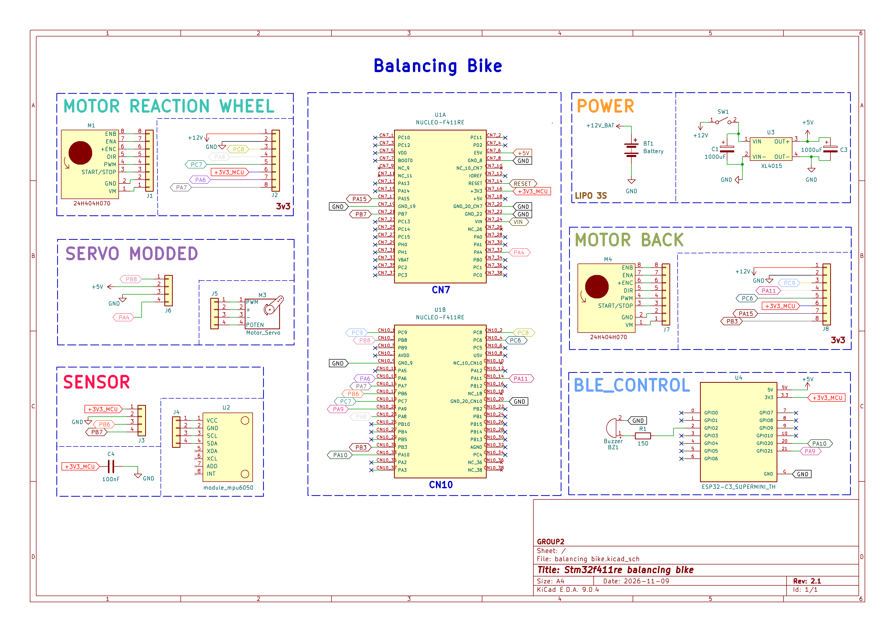

# Reaction Wheel Inverted Pendulum Self-Balancing Bicycle with Servo Steering

[](https://www.mathworks.com/)
[](https://www.st.com/)
[](https://www.espressif.com/)
[]()

Embedded control system for a two-wheeled self-balancing bicycle incorporating a reaction wheel inverted pendulum and an MG995 servo steering mechanism. All signal filtering, state-machine calibration, and closed-loop control algorithms are modeled in MATLAB/Simulink at a $200\text{ Hz}$ sample rate ($5\text{ ms}$ discrete time-step) and compiled directly to an ARM Cortex-M4 STM32F411RE microcontroller. An auxiliary ESP32-C3 Super Mini co-processor handles BLE 5.0 wireless telemetry, live parameter tuning, and gamepad steering via an inter-MCU binary UART protocol.



---

## Technical Architecture

### 1. Dual-MCU Partitioning
- **Real-Time Core (STM32F411RE @ 100 MHz):**
  - Executes the time-critical $200\text{ Hz}$ deterministic balance loop with zero RTOS jitter.
  - Manages independent hardware timers: `TIM1` (20 kHz PWM for flywheel and drive BLDC motors), `TIM3` (flywheel 4x quadrature encoder), `TIM2` (rear wheel 4x quadrature encoder), `TIM4` (50 Hz servo PWM), and `ADC1_IN4` (potentiometer feedback).
- **Wireless Co-Processor (ESP32-C3 Super Mini @ 80 MHz):**
  - Offloads the Bluetooth Low Energy (BLE 5.0) Nordic UART Service (NUS) stack to protect the STM32 from non-deterministic wireless interrupts.
  - Packages iOS gamepad commands and terminal tuning strings into fixed 14-byte XOR-checksummed binary frames transmitted at 50 Hz over USART1.
  - Features 3-tier thermal management (80 MHz CPU, 0 dBm RF, 60s Eco Standby, and 3-minute duty-cycled hibernation) with acoustic buzzer feedback.

### 2. Cascaded Two-Loop Balance Controller
- **Inner Balance Loop ($200\text{ Hz}$):**
  - Combines non-linear gravity feedforward $u_{\text{grav}} = -K_g \sin(e)$, roll angle PID with anti-windup clamping ($\pm 25.0\%$), and flywheel angular velocity damping.
  - Integrated slew-rate limiter ($\Delta u \le 8.0\% / 5\text{ ms}$) prevents high-frequency chattering and protects motor drive circuitry.
  - Soft linear power derating between $2500\text{ RPM}$ and $3000\text{ RPM}$ avoids voltage saturation caused by motor back-EMF.
- **Outer Momentum Dumping Loop:**
  - Dynamically trims the roll balance setpoint ($\dot{\theta}_{\text{offset}} = -K_{\text{trim}} \omega_{\text{wheel}} / 1000$) using TIM3 encoder velocity feedback.
  - Automatically compensates for physical center-of-mass shifts and drains flywheel momentum back toward $0\text{ RPM}$.

### 3. Nidec 24H BLDC Actuator Interface
- Active-low $20\text{ kHz}$ PWM with deadband compensation starting at $94.5\%$ duty cycle.
- 1-sample power blanking ($100\%$ duty cycle for $5\text{ ms}$) on direction reversal (`DIR`) suppresses inductive voltage spikes on the internal H-bridge.
- Two-stage electromagnetic braking (`BRAKE` pin): 0.5s freewheel coasting before hard brake engagement.

### 4. MPU-6050 Adaptive State Estimator
- 1D Kalman filter estimates roll angle and X-axis angular velocity over $400\text{ kHz}$ Fast-Mode I2C.
- Initial 200-sample stationary gyro bias calibration with busy flag signaling (`Gyro_X_Rate = 999.0`).
- Adaptive measurement noise covariance ($R$) dynamically scales up to 10x during high total acceleration ($|\mathbf{a}| \ne 1g$) to reject centripetal and tangential disturbances.

---

## Hardware Specifications

| Subsystem | Component / Parameter | Specification |
| :--- | :--- | :--- |
| **Main Processing Core** | STM32F411RE Nucleo-64 | ARM Cortex-M4 @ 100 MHz, 512 KB Flash, 128 KB SRAM |
| **Wireless Co-Processor** | ESP32-C3 Super Mini | RISC-V @ 80 MHz, BLE 5.0 NUS, 3.3V Logic |
| **Flywheel Actuator** | Nidec 24H 12V BLDC | Internal driver, 20 kHz PWM, direction & brake inputs |
| **Rear Drive Actuator** | Nidec 24H 12V BLDC | GT2 belt transmission (6 mm width, 240 mm loop) |
| **Steering Actuator** | TowerPro MG995 | Metal gear servo, 50 Hz PWM, 1.0 ms - 2.0 ms pulse width |
| **Inertial Measurement** | MPU-6050 6-DOF IMU | Mounted at 60 mm height, X-axis aligned with bike roll |
| **Reaction Flywheel** | 3D-Printed Rim-Weighted | Mass: $100\text{ g}$, Diameter: $130\text{ mm}$, $J = 3.1 \times 10^{-4}\text{ kg}\cdot\text{m}^2$ |
| **Total System Mass** | Chassis + Electronics + LiPo | $750\text{ g} - 800\text{ g}$ |
| **Power Supply** | 3S LiPo Battery (11.1V - 12.6V) | Direct 12V for BLDC motors; 5V 3A DC-DC Buck for MCUs & Servo |

---

## Repository Structure

```text
Balancing-Bike/
├── README.md                              # System architecture and technical overview
├── Schematic.png                          # Hardware wiring and inter-MCU schematic diagram
├── .gitignore                             # PlatformIO and MATLAB build exclusions
├── docs/
│   ├── references.md                      # Detailed technical analysis of benchmark literature
│   ├── hardware/
│   │   ├── pinouts.md                     # STM32F411RE pin allocation and power distribution
│   │   └── ble_connection.md              # ESP32-C3 BLE service, protocol, and command specifications
│   ├── theory/
│   │   └── dual_loop_control.md           # Equations of motion and two-loop control derivation
│   └── project_notes/
│       ├── decisions.md                   # Architecture Decision Records (ADR-001 to ADR-012)
│       ├── key_facts.md                   # Physical constants, actuator benchmarks, and motor parameters
│       ├── bugs.md                        # Root-cause bug analyses and engineering resolutions
│       └── issues.md                      # Development milestones and subsystem roadmap
└── src/
    ├── controllers/
    │   └── fcn_Balance_Controller.m       # Two-loop balance controller MATLAB function block
    ├── drivers/
    │   └── fcn_Nidec_Driver.m             # Nidec 24H 20 kHz PWM, direction, and braking driver block
    ├── filters/
    │   └── fcn_MPU6050_Filter.m           # Adaptive 1D Kalman filter block for MPU-6050
    ├── hal/
    │   ├── EncoderBlock_TIM3.m            # MATLAB System Object for TIM3 hardware encoder
    │   ├── Setup_Encoder_TIM2.m           # Setup script generating C++ register driver for TIM2
    │   ├── Setup_Encoder_TIM3.m           # Setup script generating C++ register driver for TIM3
    │   ├── include/soc_stm_encoder_tim3.h # TIM3 hardware encoder header
    │   └── src/soc_stm_encoder_tim3.cpp   # STM32 register implementation for TIM3 encoder
    └── esp32_ble_bridge/
        ├── platformio.ini                 # PlatformIO build configuration for ESP32-C3 Super Mini
        └── src/
            └── main.cpp                   # BLE 5.0 bridge firmware, command parser, and UART transmitter
```

---

## Credits & Inspirations

- **Tom Stanton** - Reaction wheel dynamics, angular velocity saturation boundaries, and zero-crossing reversal dynamics.
- **Every Flavor of Robot** - Field Oriented Control (FOC) torque considerations and outer-loop dynamic setpoint shifting for momentum dumping.
- **James Bruton** - Comparative analysis between reaction wheels and control moment gyroscopes; derivation of torque proportional to control derivative ($\tau \propto \dot{u}$) on velocity-mode BLDC drivers.
- **Sydney Madueke** - Inertia ratio optimization and steady-state angle error elimination via anti-windup integration.
- **RemRC** - Mechanical CAD baseline for the 3D-printed balancing bicycle, Nidec 24H packaging, and Arduino Nano proof-of-concept.
- **BD594 (James Cochrane)** - Nidec 24H open-drain encoder pull-up circuit configuration and inductive transient protection diodes.
- **Dmitrii Tomin** - Standardized 23-step mechanical assembly workflow and optimized 3D-printing tolerances.
- **Journal of Fuzzy Systems and Control (2024)** - Comparative benchmark study (*PID Control for Balancing Bike Model using Reaction Wheel*, Vol. 2, No. 2) analyzing single-loop vs. cascaded velocity-feedback architectures.
