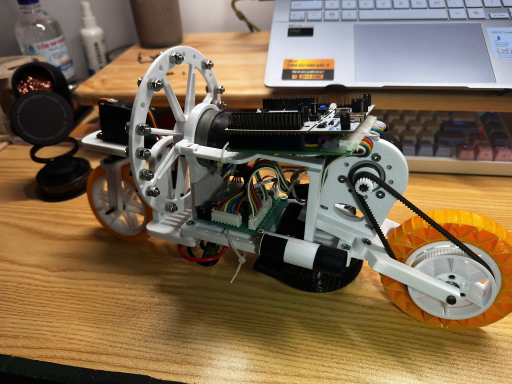
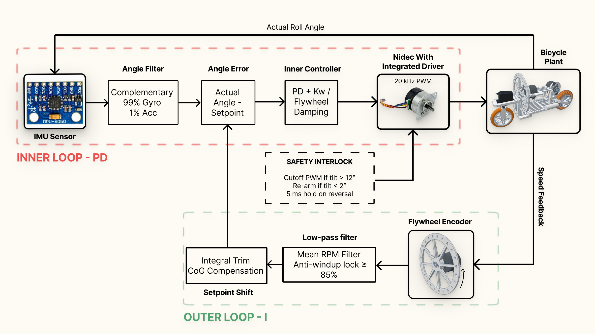
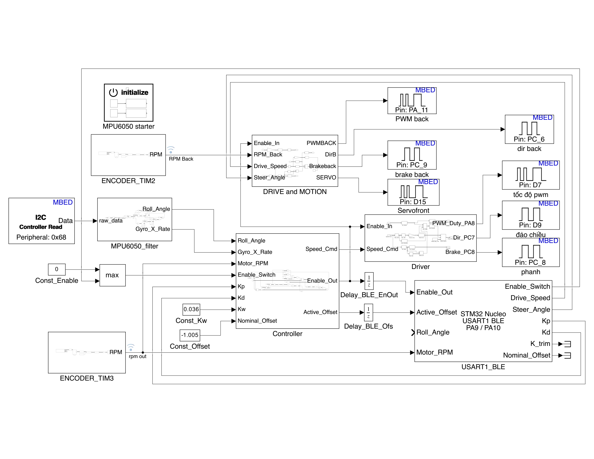
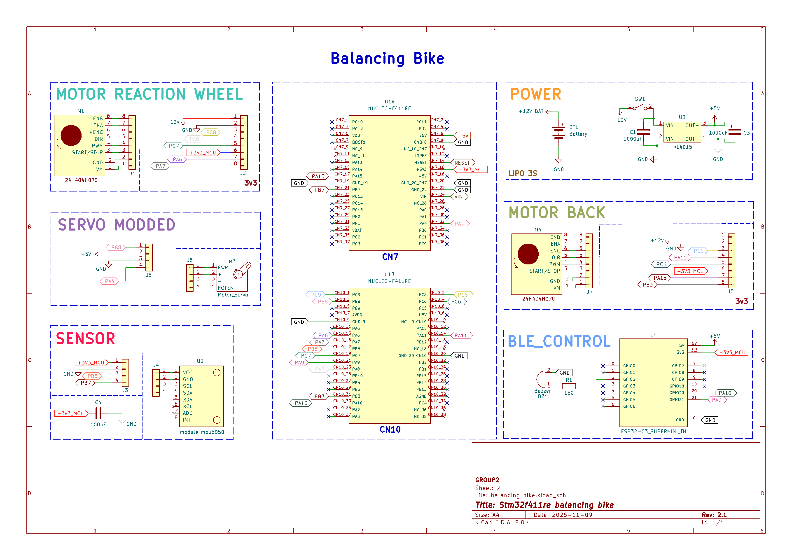

# Self-Balancing Bicycle on STM32 and Simulink

A reaction-wheel self-balancing bicycle built on an STM32F411RE microcontroller and programmed with native MATLAB Simulink blocks. Mechanical concepts are adapted from the open-source design by RemRC, paired with wireless smartphone control over Bluetooth Low Energy.

[Web BLE Controller](https://kuroquang2302-lab.github.io/Balancing-Bike/) · [Documentation](docs)

## Control Method

- **Inner balance loop:** Reacts immediately to roll angle and angular rate to keep the bicycle upright while damping flywheel speed.
- **Outer trim loop:** Gradually adapts the balance setpoint from flywheel velocity so static weight imbalance does not saturate the wheel.
- **Safety interlock:** Arms balancing only near upright, disarms on excessive tilt, and protects the motor during direction reversals.

## Simulink Architecture

The entire sensing, balancing, motor driving, steering, and wireless communication pipeline runs directly from standard Simulink blocks and hardware abstraction blocks inside `BalancingBike.slx`.

## Hardware

| Subsystem | Component | Role |
| :--- | :--- | :--- |
| Main controller | STM32F411RE Nucleo-64 | Runs the real-time Simulink control model |
| Wireless bridge | ESP32-C3 Super Mini | Handles Bluetooth Low Energy control and telemetry |
| Reaction flywheel | Nidec 24H brushless motor | Generates balancing torque along the roll axis |
| Rear wheel drive | Nidec 24H brushless motor | Drives forward and reverse motion |
| Front steering | TowerPro MG995 servo | Steers the front fork |
| Inertial sensor | MPU6050 | Measures tilt and roll angular rate |
| Power supply | 3S LiPo battery | Powers the drive motors and onboard electronics |

## Quick Start

1. Open MATLAB and add `src/hal` with its subfolders to the MATLAB path.
2. Open `BalancingBike.slx` in Simulink.
3. Connect the STM32F411RE Nucleo-64 over USB and deploy directly to the board.
4. Open the [Web BLE Controller](https://kuroquang2302-lab.github.io/Balancing-Bike/) to connect and drive wirelessly.

## Repository Layout

- `BalancingBike.slx`: Pure-block Simulink model
- `src/hal`: Hardware abstraction blocks and C++ peripheral drivers
- `src/esp32_ble_bridge`: PlatformIO firmware for the ESP32-C3 wireless bridge
- `docs`: Web BLE interface, diagrams, pinouts, and technical notes

## Credits

Mechanical frame concepts are adapted from RemRC. Reaction-wheel modeling, encoder interfacing, and hardware protection ideas draw inspiration from Tom Stanton, James Bruton, Sydney Madueke, Every Flavor of Robot, BD594, and Dmitrii Tomin.
